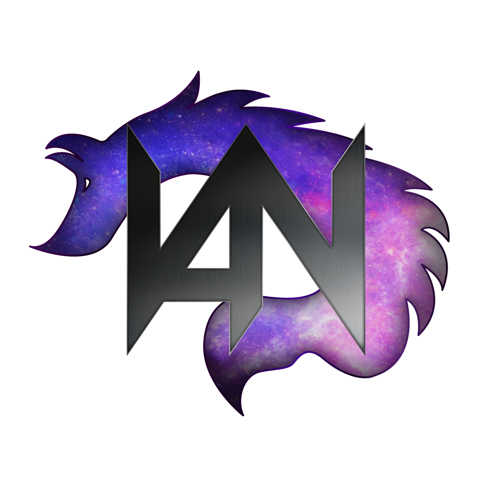
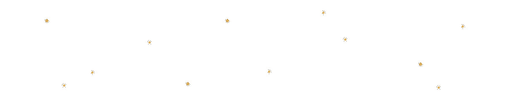
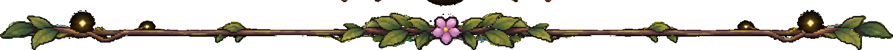
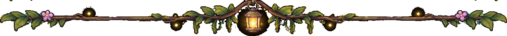
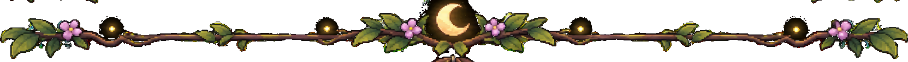

 

# Hey, I'm JustCromo!

**NETWORK & INFRASTRUCTURE SECURITY**

## 🌱 About Me

Hi! I'm interested in understanding how systems work, building useful tools, and exploring the intersection between software and security.

I enjoy working with Linux, programming, networking, and cybersecurity.

- 🔐 Network and infrastructure security.
- 🐧 Linux and system administration.
- 💻 Software development and experimentation.
- 🌐 Networking and infrastructure.

## 🍄 My Projects

<table>
<tr>
<td align="center" valign="top" width="50%">

### [Vulpnix](https://github.com/JustCromo/Vulpnix)

**Linux Risk Assessment Tool**

A Linux security assessment tool focused on identifying system risks and potential security weaknesses.

</td>
<td align="center" valign="top" width="50%">

### [Racoonix](https://github.com/JustCromo/Racoonix)

</td>
</tr>
</table>

## 🌿 My Greenhouse

**Languages & Technologies**

**Tools & Environment**

