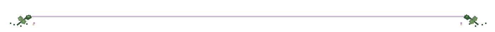
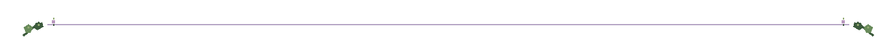
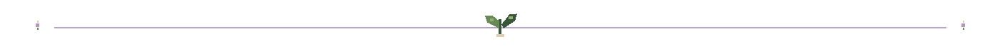

# Hey, I'm JustCromo!

**Network & Infrastructure Security** 
Student at ITS Academy Prodigi · 🌙 open to internships

### 🌱 About Me

I like to understand how systems really work, then build small tools that make them easier to read and safer to run. 
Every project in my forest has its own creature, because security tools can be friendly too.

🔐 Security &nbsp;·&nbsp; 🐧 Linux & SysAdmin &nbsp;·&nbsp; 🌐 Networking &nbsp;·&nbsp; 💻 Software Development

### 🍄 My Projects

<table>
<tr>
<td align="center" valign="top" width="50%">

### [Vulpnix](https://github.com/JustCromo/Vulpnix)

**The fox that sniffs out risks**

A Linux risk assessment tool that scans a machine and turns findings into clear, prioritized risks.

</td>
<td align="center" valign="top" width="50%">

### [Racoonix](https://github.com/JustCromo/Racoonix)

**The raccoon that guards your stock**

A self-hosted web app for small markets: batch inventory, expiry alerts and restock warnings.

</td>
</tr>
</table>

### 🌿 My Greenhouse

**Languages**

**Tools & Environment**

